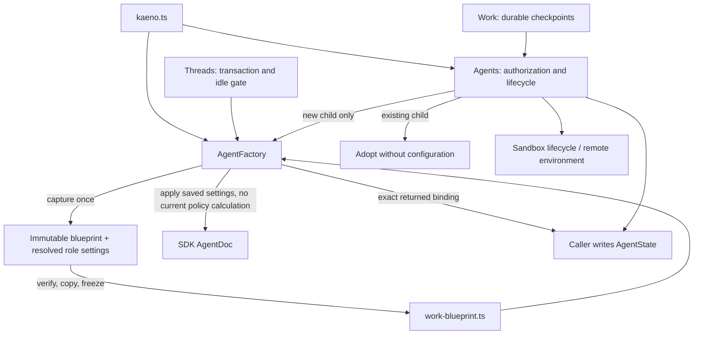

# AgentFactory: composition with immutable replay policy

## Caller first

```ts
const factory = new AgentFactory(config, skills, workSurface, sandboxCwd);
// Agent lifecycle dependencies are connected in application/kaeno.ts.
// Existing thread transaction + idle gate:
const bound = await factory.configureAgent(
  tx,
  id,
  { role: "chat" },
  agents.Kaeno,
);
// Admission captures template data AND resolved role settings:
const blueprint = agents.captureWorkBlueprint(agent);
// Agents adds real metadata in the same transaction:
await agents.configureWorkConversation(tx, id, blueprint, workId);
// Only after direct-delegate authorization and finding no existing child:
const child = await factory.configureAgent(
  tx,
  id,
  { role: "worker", agent, blueprint },
  agents.Kaeno,
);
```

The factory owns configuration and sandbox cwd, and consumes an injected `AgentSkills` capability. Agents no longer accepts independent copies of these
inputs: its live authorization uses factory.config, capture uses factory.bindAgent, and environments use the stored
SDK cwd (with factory.sandboxCwd only for old children without one). This removes conflicting injection paths,
including the previously possible mismatch between SDK cwd and RemoteExecutionEnv cwd.

## Types and ownership

- `BoundAgent`: deeply readonly template and bound skills, returned as an alias-free, deeply frozen copy.
- `AgentSelection`: CHAT always selects config.agent; WORK requires a blueprint; WORKER/legacy may resolve live
  or frozen data. Legacy is never a persisted role.
- `AgentSettings`: a complete replacement with required model, thinking, tools, extensions, instructions, cwd.
- `WorkBlueprint`: deeply readonly schema-1 snapshot, including every reachable template/skill binding, resolved
  WORK/WORKER/legacy settings per entry, execution image, cache claim, and SHA-256 checksum.
- `work-blueprint.ts`: JSON copying/freezing, checksum verification, schema support and selected-entry validation.
  No orchestration imports. `work.ts` owns orchestration, not snapshot policy.
- `Stored<T>` / `storageCopy`: explicit SDK persistence adapter. The SDK's JSON types require mutable arrays and
  transactions expose mutable drafts. Domain consumers receive frozen copies; changing stored content without
  resealing it is detected on the next blueprint read. The storage draft itself is not claimed to be immutable.



The factory never imports AgentState, owns transactions, creates/submits conversations, creates tasks/pods,
or orchestrates work. Validated config templates are the existing template registry; AgentSkills.bindSkills is
skill resolution; the private roleTools/settings functions choose policy for NEW admissions/live configuration.
Consumer-owned capability interfaces are not parallel policy registries; there is one configuration path.

## Replay guarantees

Capture visits each reachable template once, before descending, so self-cycles terminate. Each entry records
all resolved role settings, including already-rendered delegate descriptions. Future children of that work use
those settings verbatim, not current roleTools/settings/instructions, config, catalog or cwd. Lookup requires own
map entries. Captured reachability is not delegation permission: Agents checks the root's direct delegate list.
CHAT cannot foreground-delegate; WORKER is an unconditional leaf, including old no-blueprint children.

Selected entry/root checks still happen before child adoption. Adopted children are not reconfigured or rebound.
Thread refresh retains its existing idle gate. SDK configuration and Kaeno metadata are written in one existing
transaction, with metadata copied from the exact returned binding, not a second catalog lookup.

Tools/extensions are explicit allowlists. Empty tools means no tools. Null thinking/cwd clears inherited values.
Null tools is NOT used: the SDK interprets it as removing the filter, potentially exposing every extension tool.

Schema absence/unknown versions, checksum mismatch, missing targets, malformed selected data, missing tool or
extension implementations fail closed. Old unversioned work is not silently upgraded by running today's policy.
Inspect/drain or cancel it before rollout and submit fresh requests. There is no automatic snapshot migration.

## Scope and security limits

This hardening addresses accidental in-process mutation and policy drift across configuration/restarts. Deep
readonly types reject edits; Object.freeze blocks them at runtime; restoration copies/refreezes; checksums detect
accidental storage edits and corruption. A checksum is NOT authentication: anyone who controls the process or
SQLite can recompute it or change AgentDoc. The snapshot pins configuration/capability decisions, not arbitrary
JavaScript implementations of tools, hooks or orchestration. Those still come from the installed application/SDK;
freezing an entire executable environment would require a separate deployment/version compatibility design.
Skill provenance/provider authenticity validation is not broadened by this change.

WORK execution remains a separate requested lifecycle change: this patch preserves the current WORK policy
(no coding tools or sandbox) and does not expose host tools without sandbox provisioning/recovery/cleanup.
The feature refactor adds validation/format/lint tooling and injects logging; it does not perform cluster writes or deployment.

## Synthesis decision

A (chosen): save complete resolved configuration as immutable, checksummed data and give Factory sole ownership
of shared composition inputs. This captures exactly what new children must run with and deletes duplicate inputs.
B (rejected): retain multiple historical executable policy functions and select by version. That leaves correctness
dependent on never editing an old function and adds a long-lived policy dispatch mechanism.

Principles: encode lessons in structure (readonly types, runtime freezing, checksums, required settings fields);
boundary discipline (one replay-data module, explicit storage adapters); laziness (delete conflicting dependency
inputs rather than compare them at runtime); minimize reader load (saved configuration is the replay authority).

## Verification

Regression coverage includes the role/template matrix and explicit inherited-capability clearing; forbidden live
config/catalog/policy access during frozen configuration; self-cycle capture; malformed selected entries; readonly
compile-time contracts; deep runtime freezing and alias isolation; checksummed template/skill/image/policy edits;
unsupported schemas; missing tool/extension implementations; saved SDK/remote cwd agreement; existing-child
adoption without configuration; and creation of queued WORK plus a new WORKER after SQLite reopen with later
policy code deliberately disabled. Existing SQLite/pod recovery and receipt-first tests remain in place.

Historical PR #7 verification (before the feature refactor): Node 26.10.0 / npm 11.19.1; `npm ci`, `npm run check`, `npm test` (139 tests / 14 files),
and `git diff --check` passed. No Node 24 rerun, real cluster or deployment verification was performed.
